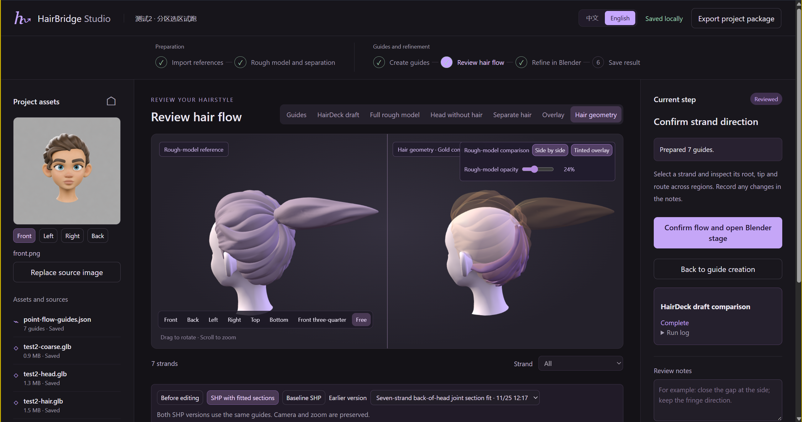

# HairBridge Studio

README prose word count: 750 (excluding headings, metadata, code blocks, image captions and URL targets).

I built HairBridge Studio to edit generated hair one strand at a time. The
browser workspace lets me review the references, select hair regions, fit
guides and adjust cross-sections. The Blender companion builds editable
geometry with Stylized Hair PRO (SHP) and sends edited copies back for review.
Use **中文 / English** in the top bar to switch languages.



A2 report: [PDF](docs/report/HairBridge_Studio_A2_Report.pdf) or [illustrated Markdown](docs/report/HairBridge_Studio_A2_Report.md).

## Start

Use Node.js 22 or later. Copy `local-config.example.json` to
`local-config.json` and set your Blender executable. Run the following from the
repository root. On Windows you can also double-click `Start_HairBridge.bat`.

```powershell
npm start
```

Open <http://127.0.0.1:8787>. Projects are saved in `data/projects/`. Export a
project package from the workspace to keep its file, assets and history together.
[English installation guide](docs/installation.en.md) ·
[Chinese installation guide](docs/installation.zh-CN.md).

## Install Blender tools

Open **Preferences → Add-ons → Install from Disk**. Install and enable these
three add-ons:

1. [Surface Hair Curve Tool](installers/surface_hair_curve_tool.zip) for editable
   guides, grouping and presets.
2. **Stylized Hair PRO 4.3.1** for geometry generation. [Dean Zarkov's product page](https://deanzarkov.gumroad.com/l/stylized_hair_pro).
3. [HairBridge Studio](installers/hairbridge_studio.zip), the Blender companion
   with the JSON bridge built in. Disable the older standalone HairDeck JSON
   Bridge if it is installed.

The companion and this version of SHP need Blender 5.2 or later. I used Blender
5.3.0 for the recorded checks. In the 3D View, press **N** and open **HairBridge**.
Open a built `.blend` or load `project.hairbridge` with its asset folders.

For assessment, extract the separate `A2_Teacher_Verification.zip`. It contains
the two project add-ons and the SHP dependency. Follow `TEACHER_README.md` inside
the archive and install each of its three inner ZIPs with **Install from Disk**.
[Assessment attachment details](docs/teacher-verification.zh-CN.md).

## Try the supplied test materials

The Rain study includes an initial image and four reference views. Left and
right refer to the character's own sides. To open the seven-guide example, run
these commands from the repository root and open the URL printed by
`npm run example`.

```powershell
npm run example
npm start
```

Each run creates a local copy with the references, meshes, regions, guides and
section settings. You can inspect the guides immediately and build a new
`.blend` once SHP is installed. The sample uses saved generation outputs.
**Rain Rig (CC) Blender Foundation | studio.blender.org.**
[Rain study and asset credits](examples/rain-study/README.md).

## Review workflow

1. Upload an initial image and prepare four views. Check each view before approving it.
2. For a new model, use the Tripo Studio handoff and review the whole, head and
   hair GLBs from the same candidate.
3. Correct the region selection, preview the guide and compare any replacement
   before adopting it.
4. Check the guide from root to tip. Adjust the cross-section, then build the
   geometry to inspect the result.
5. Edit in Blender, return a review copy and approve the version to export.

Changing an input clears the approvals that depend on it. You can switch the
interface language at any stage and continue with the same edits.

The workspace uses a local Node.js server and a Three.js viewer. Codex helps
hand off tasks to ImageGen for reference views and Tripo Smart Mesh P2.0 for
rough geometry. Tripo Studio needs a signed-in session with credits. HairDeck
can generate draft guides locally with its own environment and model weights.
The Rain sample builds from saved guides. [Third-party sources](THIRD_PARTY_NOTICES.md).

## Verify and rebuild

Use Python 3.10 or later for the bundle checks and packaging.

```powershell
npm test
npm run verify:bundle
npm run package:addon
```

The repository includes regression tests, checksums and tools for running Blender
checks in an isolated profile. GitHub Actions runs the Node and bundle checks.
[Reproduction guide](docs/reproduction.en.md) · [Validation](docs/validation.md).

I completed the workflow on the supplied Rain example. Coverage and
intersections between strands still need visual review. I have not measured
editing time or tested whether the method works across other hairstyles.
Draw-hair refinement remains future work.
[Submission evidence](docs/submission-validation.zh-CN.md) ·
[Closure comparison](docs/evidence/closure-comparison.md).

## Development and AI assistance

I prepared the project dataset and wrote Surface Hair Curve Tool with help
from Codex. I also used Codex to implement and test parts of the workspace,
edit the report and make explanatory figures. I chose the local workspace,
the Blender companion and the Tripo handoff. I used ImageGen to prepare the
four Rain reference views and revised the framing and ponytail for consistency.
[Development record](docs/development.md) · [Rain study](examples/rain-study/README.md).

I asked Codex to help test the guide for Rain's S-shaped fringe. In the
render comparison, ordinary smoothing flattened the curl. Keeping the marked
bends raised the local front-view silhouette overlap from 67.13% to 82.25%.
The sharpest turn fell from 44.85° on the extracted guide to 20.66° after
smoothing around the markers. This is why I let the modeller move the root,
tip and bend markers and preview the smoothed guide before approving it.
[Figure 2 and measurements](docs/report/HairBridge_Studio_A2_Report.md#figure-2-smoothing-and-preserving-the-main-bend) ·
[Anchor preservation test](tests/anchored-guide-edit.test.mjs#L8).

Keep account credentials and personal configuration in your local workspace.
