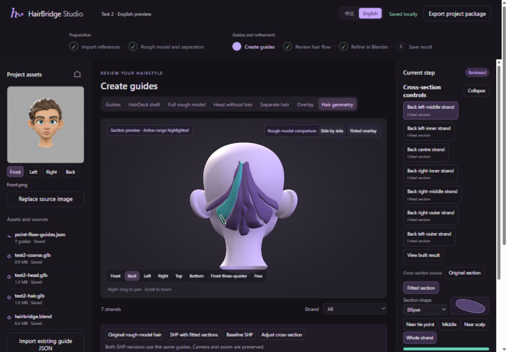

# HairBridge Studio

README prose word count: 802 (excluding setup commands and URL targets).

A local workspace and Blender companion for turning generated character hair
into editable guides and SHP geometry. Review references, check separated hair,
refine regions and guides, adjust cross-sections, then build and review the result
in Blender. The interface defaults to English; use **中文 / English** in the top
bar to switch. Your language choice is remembered.



## Start

Use Node.js 22 or later. No npm runtime dependencies are required. Copy
`local-config.example.json` to `local-config.json` and set your Blender executable.
On Windows, double-click `Start_HairBridge.bat`, or run:

```powershell
npm start
```

Open <http://127.0.0.1:8787>. The server listens only on loopback. Projects persist
under ignored `data/projects/`. Export a project package from the interface to
keep its manifest, assets and history together. See the
[English installation guide](docs/installation.en.md) or
[Chinese installation guide](docs/installation.zh-CN.md).

## Install Blender tools

In Blender Preferences → Add-ons → Install from Disk, install and enable:

1. [Surface Hair Curve Tool](installers/surface_hair_curve_tool.zip): this project's
   editable-guide, grouping and preset tool. Source is in `addon/`.
2. **Stylized Hair PRO 4.3.1**: obtain separately from
   [Dean Zarkov](https://deanzarkov.gumroad.com/l/stylized_hair_pro).
3. [HairBridge Studio](installers/hairbridge_studio.zip): this project's companion,
   including its internal JSON bridge. Disable the older standalone HairDeck JSON
   Bridge if present.

Recorded checks used Blender 5.3.0. The companion and selected SHP release need
Blender 5.2+. In the 3D View, press **N** and open **HairBridge**. The companion's
language control also controls the Surface Hair interface. Load
`project.hairbridge` with its adjacent asset folders, or open a generated Blend.
Third-party tools retain their own language support.

Both author-developed installers, source and checksums are included. SHP is
provided separately for assessment, outside this public repository. HairMesh and
Hair Curve Toolkit are earlier comparison tools, not runtime dependencies; their
source and demonstration links are in [source notices](THIRD_PARTY_NOTICES.md).
Draw-hair refinement remains future work.

## Try the supplied test materials

The [Rain study](examples/rain-study/README.md) includes **one initial image and
four separate front/left/right/back reference images**. Use them to start a new
image project. Left/right refer to the character's own sides.

For inspection without new AI generation, install an existing seven-guide study:

```powershell
npm run example
npm start
```

Open the URL printed by the first command. Each import creates a new local copy
with the five images, whole/head/hair GLBs, an auxiliary measurement mesh, region
assignments, guides and section settings. The same sample is available through
the existing Rain demo loader. Build a new Blend with your installed SHP; no
pre-approved final result is supplied. Personal paths and historical task text
are removed. The original experiment directory is unnecessary for this sample.

The images and geometry derive from Blender Studio's Rain character and the
project's AI-assisted reference/Tripo experiments. **Rain Rig (CC) Blender
Foundation | studio.blender.org.** See [provenance and credit](examples/rain-study/README.md).
AI views are interpretations, not official Blender Studio turnarounds.

## Review workflow

1. Upload an initial image and prepare or upload four reference views. Check and
   approve each view before continuing.
2. Prepare the combined Tripo generation/separation task. Select one candidate
   for both its head and hairstyle. Review whole/head/hair GLBs in the same frame.
3. Check region face selections and proposed guides. Compare replacements before
   adopting them. Region and guide interactions are validated on the study mesh.
4. Review root-to-tip flow and cross-sections. Adjust width, thickness, profile,
   range and scalp-end inset. A browser preview and built SHP geometry are distinct.
5. Build in Blender, edit guides, return a review copy, compare matching cameras,
   approve the chosen result and export the project package.

Changing inputs invalidates downstream approvals. Successful processing never
approves a result automatically. Language switching retains current edits; user
names, notes, paths and identifiers preserve their original values. New agent
tasks include both languages and copy the selected version.

Tripo requires your own signed-in session and service credits. Optional local
HairDeck inference requires its separately installed environment and model
weights. Neither inference environment nor weights are bundled. Existing-guide
Blender builds do not require model inference.

## Verify and rebuild

Use Python 3.10+ for bundle verification and packaging:

```powershell
npm test
npm run verify:bundle
npm run package:addon
```

The public bundle includes regression tests, checksums and isolated Blender
verification tools. Follow [the reproduction guide](docs/reproduction.en.md)
for exact scope and commands. GitHub Actions runs the Node and bundle checks;
it does not run paid services or Blender/SHP checks. The older original-Rain
integration helpers remain documented as historical tools with external inputs.

The selected example completed the main workflow; coverage and neighbouring
strand intersections still require visual review. General hairstyle performance,
editing-time benefits and participant usability are untested. See
[validation](docs/validation.md), [submission evidence](docs/submission-validation.zh-CN.md),
[curve-system design](docs/curve-system.zh-CN.md) and
[interaction design](docs/interaction-design.zh-CN.md).

LU WENXUAN prepared the project dataset and authored Surface Hair Curve Tool with
Codex assistance. Codex also helped implement the workspace, adapters and checks.
Existing HairDeck frame mathematics and the earlier bridge are credited separately
in [source notices](THIRD_PARTY_NOTICES.md). See [development](docs/development.md)
for decisions and [all dependency notices](THIRD_PARTY_NOTICES.md) for upstream
terms. Accounts, keys, personal configuration, runtime projects and private teacher
attachments are excluded from this repository.
