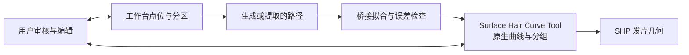

# HairBridge 导线系统的技术基础与开发历程

Surface Hair Curve Tool 是作者在 Codex 协助下编写的 Blender 曲线基础模块，也是本工作流的核心组件之一。它把生成或提取的路径变成可以继续编辑、分组和交给几何工具处理的曲线对象。整个导线系统还包括桥接拟合、网页中的路径修正，以及曲线变化后的截面处理；这些工作分布在不同模块中。

## 各模块的职责

| 模块 | 实际负责的内容 | 对创作者的作用 |
|---|---|---|
| Surface Hair Curve Tool | 创建和更新原生 Bézier 曲线，采样和重采样，维护曲线与分组标识、集合及显示属性，提供表面吸附接口 | 保留可编辑的导线对象，组织多束头发，继续在 Blender 中修改 |
| HairDeck JSON Bridge | 读取导线和截面数据，转换坐标，逐步调整控制点数量并检查路径偏差，再连接 SHP | 将外部结果转换成可编辑工程，并检查转换后的形状偏差 |
| 网页工作台的导线处理 | 根据选区和点位生成或修正路径，保留关键锚点，审核区域和发束归属 | 用户决定需要保留的走向、主弯和编辑范围 |
| HairBridge 精修与 SHP | 导线修改后的截面重定位、宽厚与端部调整、几何生成及独立撤销 | 检查走向与实际体积、搭接是否都符合目标 |

Blender 中的曲线分组用于组织对象，网页中的发流分区用于表达编辑范围和审核状态。两者可以建立对应关系，但曲线被放进一个集合，并不表示系统已经正确识别了其语义发束。

## 为什么使用 Bézier 曲线

一段三次 Bézier 曲线由两个端点及两个手柄确定。实现按下式采样：

`B(t) = (1−t)³P₀ + 3(1−t)²tH₀ + 3(1−t)t²H₁ + t³P₁`。

控制点确定曲线经过的位置，手柄影响进入和离开该点的方向及弯曲。插件使用 Blender 原生曲线数据，因此生成后的导线仍能在编辑模式中调整。曲线位置和手柄可以转换到世界坐标读取，再变回对象局部坐标写入，便于与粗模、导出数据和其他编辑工具交接。

插件也提供按弧长重采样：先累积路径长度，再在等距离位置取点。它让后续比较和处理不必完全依赖原始顶点分布。重采样本身不判断造型是否正确。

对应实现：[曲线与手柄数据](../addon/surface_hair_curve_tool/curve_data.py#L269)、[三次曲线采样](../addon/surface_hair_curve_tool/curve_data.py#L334)、[弧长重采样](../addon/surface_hair_curve_tool/curve_data.py#L368)、[原生曲线创建](../addon/surface_hair_curve_tool/curve_data.py#L635)。

## 如何将采样路径转换为可编辑曲线

桥接层的 `fit_guide` 从路径中选取控制点，调用 Surface Hair Curve Tool 创建曲线，再对曲线密集采样。它分别计算源路径到拟合路径、拟合路径到源路径的最大点到折线距离，以检查形状是否偏离。偏差较大时逐步增加控制点。

当前实现的检查基于有限采样和折线距离，不能当作解析曲线的严格误差界。控制点逐步增加也不表示找到了全局最少的控制点。若自动手柄持续造成尖角过冲，桥接层会改用向量手柄保留路径转折；随后仍需检查是否存在不希望保留的折点。

对应实现：[桥接拟合](../addon/hairbridge_studio/hairdeck_bridge/__init__.py#L77)、[点到折线距离](../addon/hairbridge_studio/hairdeck_bridge/mapping.py#L16)。

## 为什么把平顺和关键点分开处理

粗模面片会带来小幅折点，但强制平顺也可能改变需要保留的 S 形反弯。工作台的路径处理因此保留用户指定的锚点，在锚点之间修正小幅折动，并提供局部区段调整。补线会检查锚点是否位于当前选中的面上，沿连通面寻找路径，再进行插值和几何处理。这部分算法位于工作台，不能全部归为 Blender 插件的功能。

测试2的 S 卷对照表明，普通平顺将最大相邻转角从44.85°降至9.57°，正面局部轮廓交并比却从88.52%降至67.13%；保留主弯后两项分别为20.66°和82.25%。这支持让用户确认主弯和造型取舍，不能据此保证所有发型的拟合质量。

对应实现：[锚点平顺及局部编辑](../public/point-flow-fit.mjs)、[选区内补线](../public/manual-guide.mjs)；[样例对照](submission-validation.zh-CN.md)。

## 曲线分组怎样保持可追溯

Surface Hair Curve Tool 为曲线和分组生成稳定标识，并将组映射到 Blender 集合。集合也保存组标识，重建对应关系时可以按标识查找，而不只依赖可能改变的名称。曲线创建时登记所属组，移动对象时调整相应集合链接，同时设置显示颜色等属性。

网页则另外保存发束标识、区域归属、审核和生成状态。它解决“本次要编辑哪些束”的问题。分组基础设施与用户的语义审核相互配合，界面仍需让人检查跨区长束是否被完整保留。

对应实现：[组与集合映射](../addon/surface_hair_curve_tool/curve_data.py#L178)、[曲线归组](../addon/surface_hair_curve_tool/curve_data.py#L210)、[工作台分区与任务](../lib/surface-flow.mjs)。

## 从实验到当前设计

| 开发中的问题 | 采取的处理 | 已有依据及边界 |
|---|---|---|
| HairDeck 输出需要继续编辑 | 将采样数据转换为原生曲线，再映射到 SHP 截面 | 已有导线、实际几何和重开检查；转换成功不表示造型正确 |
| 需要判断生成结果的偏差来自哪里 | 用 Rain 原模曲线与截面检查重建链路，另比较原生输出与 SHP 结果 | 支持样例中的转换可行性；原模信息进入重建，不能当作独立推断 |
| 粗模提取存在急转，直接平顺又改变主弯 | 加入根梢、主弯确认和约束修正 | S 卷对照支持该取舍；后续七束重做已有采用、构建和完成记录 |
| 多束候选和区域状态需要组织 | 使用曲线及分组标识、集合管理，再在工作台加入区域审核与按束生成 | 新面选区另有画笔、清理预览及采用/撤销的回归记录 |
| 改导线后截面可能移位，影响搭接 | 按新弧长与切向重新安放截面，独立保留截面撤销 | 已有局部修正、重定位及几何检查，未证明所有穿插都已解决 |

这些阶段描述整套导线系统的开发依据，相关改动分布在插件、桥接、工作台和精修模块，不应写成 Surface Hair Curve Tool 单一目录的完整修改历史。

## 可用于报告正文的说明

我编写的 Surface Hair Curve Tool 为 Blender 端提供可编辑曲线和分组管理。桥接层将生成或提取的采样路径拟合成 Bézier 导线，并检查转换偏差。后续实验让我把主弯确认、分区审核及截面重定位加入导线系统，让用户能分别处理走向、编辑范围和实际发片的搭接。工具与桥接代码由我在 Codex 协助下开发，采用的第三方模型和几何工具另行注明。

## 验证与提交范围

[已有 Blender 功能记录](../docs/blender-functional-check.json)检查了52条导线、编辑后的几何响应及恢复。[导线校正记录](evidence/earlier-workflow-verification.json)保留了根梢、邻束和截面影响的具体对照。当前34项自动检查已复跑通过，覆盖关键点和平顺、选区清理、截面及状态行为；后续七束闭环和独立安装结果见[提交验证整理](submission-validation.zh-CN.md)。

Surface Hair Curve Tool 仍作为独立插件启用，其源码与节点预设已纳入 `addon/surface_hair_curve_tool/`，独立安装包为 `installers/surface_hair_curve_tool.zip`。HairBridge 配套插件与它分别安装；SHP 从作者渠道或单独教师附件安装。参见[安装说明](installation.zh-CN.md)与[教师附件说明](teacher-verification.zh-CN.md)。安装验证与最新发流生成、外观验收的状态分别记录在[验证记录](validation.md)。
