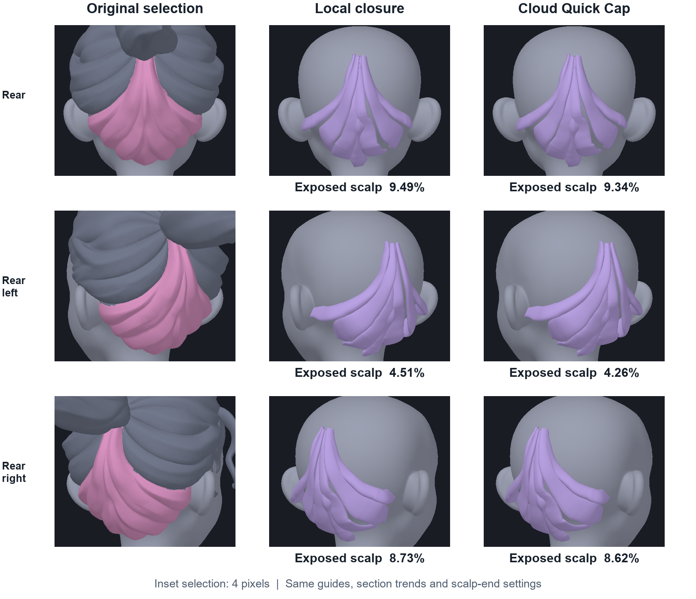

# Local closure and Tripo Quick Cap

This is additional report evidence prepared after the fixed `v0.1.0-a2` release.
It does not change the code or claim that this comparison is in that release.

The comparison holds the seven guides, section trends and scalp-end settings
constant. Exposed scalp is measured within the selected region after a four-pixel
inset. Lower values indicate less exposed scalp in this particular projection.

| Camera | Local closure | Cloud Quick Cap |
|---|---:|---:|
| Rear | 9.4864% | 9.3436% |
| Rear-left | 4.5064% | 4.2572% |
| Rear-right | 8.7301% | 8.6239% |

In the rear-left view, the relative reduction is 5.5305%, while the absolute
reduction is 0.2492 percentage points. This is one view of one study example,
not an overall quality improvement or a statistically established benefit.
The cloud result still has 12 boundary edges and 24 non-manifold edges. Its
outward-depth P95 is slightly higher in all three views. Mesh closure and
intersection handling therefore remain under improvement.

[Numerical measurements](closure-comparison-metrics.json) and
[topology/alignment record](closure-topology-alignment.json) preserve the exact
values. Quick Cap is described in
[Tripo's segmentation documentation](https://www.tripo3d.ai/product-doc/module-post-processing/segmentation).
The image uses original experiment renders with English labels; its layout
provenance is recorded in [closure figure provenance](closure-figure-provenance.json).

Character source: [Blender Studio Rain v3](https://studio.blender.org/characters/rain/v3/).
Rain Rig (CC) Blender Foundation | studio.blender.org.
This comparison is separate from the earlier UV-section fitting comparison.
