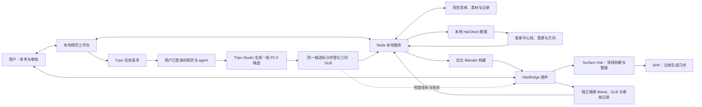

# HairBridge Studio：交互范围与系统设计

## 目标用户与任务

用户是会检查和调整风格化角色发型的创作者，希望从参考图获得可编辑的初稿，并能局部修正刘海、侧发和发梢。系统负责整理文件、运行生成、转换表示、展示结果与保存记录。用户负责造型判断、选择候选、粗模对齐和验收。

本项目的目标是建立可检查、可回退的交互闭环。视觉工作台不意味着现有算法已经具备通用、全自动重建能力。

## 主流程

| 阶段 | 用户操作 | 系统响应 | 确认与纠错 |
|---|---|---|---|
| 导入参考 | 上传一张原图，请 Codex 补齐正、左、右、背视图，逐张核对 | 保存原图、任务和单张视图，记录来源哈希 | 可替换或重补单张。四张确认后准备粗模 |
| 粗模与拆分 | 发出一条任务，查看结果的整头、头皮、头发及叠加预览 | agent 用四视图生成一批候选，从同一个候选导出整头、头皮和头发三份 GLB，保持同一坐标 | 叠加检查发际线、耳后、后颈和马尾。通过后完成准备阶段 |
| 导线生成 | 打开拟合任务，导入发束导线 JSON | 将审核过的头发和头皮交给拟合任务，或用本地 HairDeck 生成导线及截面 | 检查发束数量和整体位置后进入发流确认 |
| 确认发流 | 切换机位、选择发束、记录保留或修改意见 | 高亮导线与根梢；Rain 试跑可叠加粗模及标记，并检查邻束 | 逐束保存决定后确认进入 Blender |
| Blender 精修 | 选中一束，锁定根梢，移动控制点后确认，或调宽厚、朝向和收尖 | SHP 重建所选束；发流编辑后按弧长和切向重定位截面 | 最近一次截面调整可独立撤销。系统保留已经修改的导线 |
| 保存结果 | 返回精修副本、用固定机位对照、确认并导出项目包 | 保存各版独立 Blend/GLB、审核状态与开发记录 | 可恢复同一输入下的早期版本及其审核状态 |

工作台的粗模、导线和发片预览共用正面、背面、左面、右面、顶部、底部、前三分之四和自由视角。左、右以角色自身为准。固定机位可缩放和平移，切换同一项目的前后版本会保留当前画面。

图片入口从「导入参考」开始，已有 GLB 入口从「导入粗模」开始。图片路线确认同一候选导出的头皮和头发后进入导线生成。GLB 路线可导入已对齐的分件，或以整头为参考进入导线生成。两条路线共用发流审核、Blender 精修和版本保存。

## 为 A2 展示的三个场景

1. **从参考到初稿。** 添加 Rain 参考图、确认、运行 HairDeck，展示生成中的反馈以及真实输出；旋转初稿后决定继续。
2. **发现并修正局部问题。** 在工作台选择一束刘海、记录走向问题，在 Blender 修改控制点或基于已对齐粗模做有限表面修正；比较前后状态，并演示撤销。
3. **返回与保存。** 在插件保存审核副本，网页自动显示返回状态；用户检查后确认，导出包含素材和记录的项目包。补充展示更换输入使旧确认失效。

这些是制作证据的场景，不应当写成已经开展的用户研究。是否改善编辑时间，需要另行设计对照任务并测量。

## 系统架构

### 已实现与边界

- 本地服务直接调度已有 HairDeck Python 环境，使用现有模型推理，不重新训练。
- 新项目的四视图通过 Codex 补图任务回填，也可由用户逐张上传。HairDeck 使用已确认的正面图，Tripo 任务带上整组已确认的视图。更换原图后需要重新补图和确认。
- Tripo 由 agent 在用户登录的网页中运行。工作台绑定四张已确认的参考图，三份结果齐全后一起发布，经过用户确认再作为导线参考。
- 插件沿用 HairDeck JSON Bridge，Surface Hair 管理曲线，SHP 生成几何。
- 新增的粗模表面修正是有人工对齐前提的几何操作，不等于 Rain 实验中的发脊追踪、分束语义判断或体块重建算法。
- Rain Tripo 试跑从已保存的四视图、对齐的 P1.0 粗模、逐束标记和实际导线创建新项目。连接、拆分和反向是留给 Blender 的审核决定，当前单束编辑操作面向现有控制点。
- 通用自动对齐、自动分束、自动质量评价和完整动画流程仍是后续工作。

## 从 Charakuru 借鉴的内容

借鉴项目连续保存、阶段结果审核、用户保留视觉决策和 agent 承担工具操作的交互思路。独立编写本地应用，没有复制 Charakuru 的项目协议、应用模块、技能或角色资产。

Three.js 的 MIT 第三方文件从本机安装副本取得，保留原许可并在来源说明中单列；这不意味着 Charakuru 的应用代码可随本项目再分发。

## 报告写作的重点

整合本身不是完成 A2 的充分条件。报告需说明这些阶段如何对应用户任务、为什么需要审核与纠错、AI 与确定性处理分别做什么，以及哪些结果已经验证。课程概念应根据第 1–4 周的实际课件逐项对应，不只列术语。

建议将提交范围定为“参考图到可编辑发片的本地交互原型”，用少量真实场景证明整个交互，而不是承诺生产级的一键发型重建。
