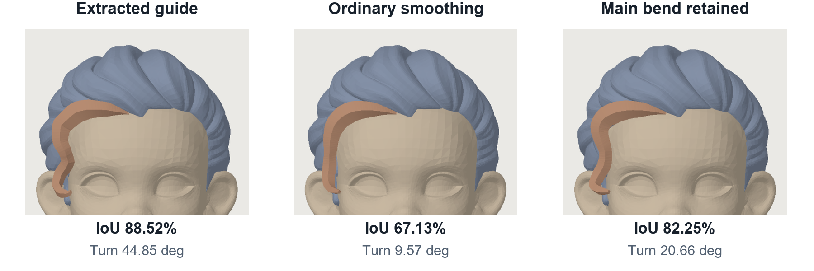
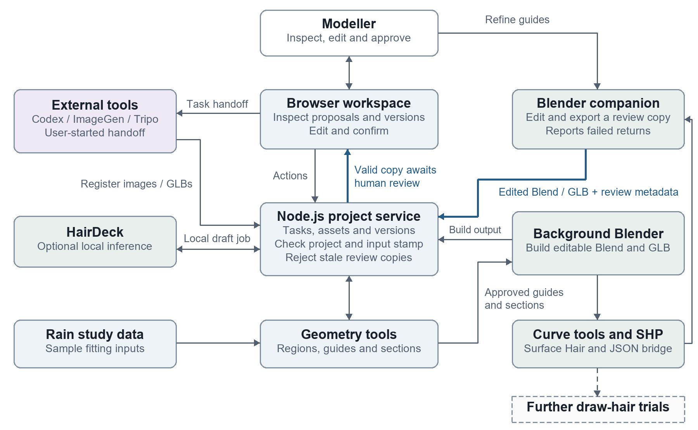
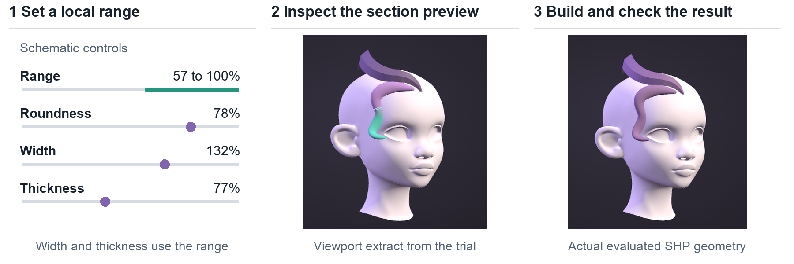
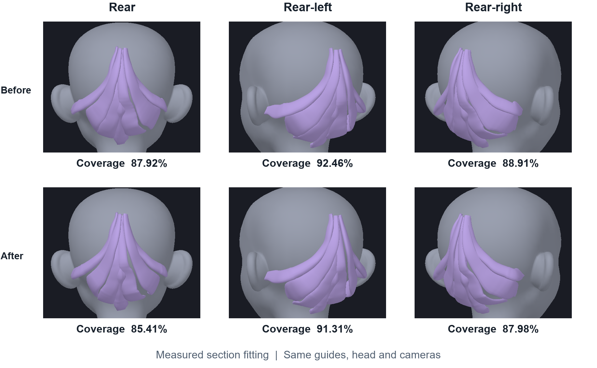

# HairBridge Studio

**A2 Project Report**

Developer | 25 November 2026

**Word count:** Main report 1,088. Abstract 208. Total 1,296. Main headings are included. Figures, short captions, references and repository links are excluded.

## Abstract

Generated hairstyles can look convincing as a whole while being awkward to edit. Hair pieces may be fused together or split into fragments, making it difficult to select and adjust the strand a modeller has in mind. Building on A1's focus on strand integrity and local editing effort, I developed HairBridge Studio, a local prototype for working with generated stylised hair.

The prototype combines a browser workspace with Blender tools, using reference images and rough geometry as its starting point. It connects reference review and hair separation with guide and cross-section editing, geometry construction and saving. Users can check proposed strands, adjust their flow and local width or thickness, and compare or restore versions. Stage confirmations, task states and review records keep decisions about grouping and acceptable results with the modeller.

The workflow has been completed on a Rain-derived example, including region review, guide replacement, cross-section adjustment, Blender construction and final approval. Seven guides for the back of the head produced an editable project and preview. Separate checks covered local editing, undoing cross-section changes and restoring versions. Results still need visual judgement of coverage, thickness and overlap. I have not yet tested other hairstyles or measured editing-time savings. Further seam and shape refinement using draw-hair remains future work.

## Problem and scope

My starting point was a problem from A1. If a piece of generated hair is fused to its neighbours or split into fragments, selecting it can require repairs. I built HairBridge Studio so a modeller can define the piece on a rough mesh and carry it through to an editable strand in Blender.

I developed the workflow on one Rain-derived example. The modeller can correct regions, choose guides, adjust the hair's shape and return an edit from Blender for review. Region selection and fitting still rely on the data supplied with the example.

## Design rationale

I started with HairDeck because its control points, widths and thicknesses can be edited (He et al., 2026). I liked this way of describing hair when I reviewed CHARM for A1 (He et al., 2025). In my Rain trials, the fringe placement, ponytail length and strand count differed from the reference. I kept those controls and looked for a better starting shape.

I worked backwards from Rain v3's original meshes (Blender Studio, 2025). I used their UV coordinates to sample cross-sections and joined the section centres into guides. I measured each section's width, thickness, orientation and outline. With the same 17 guides, using measured 16-point profiles in place of four-point sections raised the front-view silhouette intersection over union (IoU) from 82.23% to 94.38% (Figure 1). I then tried extracting both from generated meshes.

### Figure 1. Reconstruction from the original mesh

| Front-view silhouette IoU | Result |
|---|---:|
| Initial HairDeck generation | 42.50% |
| Earlier edited version | 76.70% |
| Original guides, four-point sections | 82.23% |
| Original guides, 16-point sections | 94.38% |

The two measured reconstructions use the same 17 guides and profiles derived from the original mesh. [Measurement record](https://github.com/Misato-R/HairBridge-Studio/blob/v0.1.0-a2/docs/evidence/rain-reference-metrics.json). Rain Rig (CC) Blender Foundation | studio.blender.org.

HairLRM's mesh constraints and HairFlow's use of geometry and directional guidance gave me a reason to start from a rough mesh (Shen et al., 2026; Wang et al., 2026). I tried Tripo Smart Mesh P2.0 (Tripo, 2026a) and separated the head and hair from the same Rain result so they stayed in the same coordinate frame. From there, the workflow uses geometry processing and the modeller's review.

Some extracted guides still wobbled or twisted. Ordinary smoothing flattened the S-curl and reduced local silhouette IoU from 88.52% to 67.13%. Keeping the main bend brought it to 82.25% (Figure 2). That is why the modeller checks the root, tip and key bends before adopting a replacement guide.

I compared local mesh closure with Tripo's cloud Quick Cap to see whether either would give me a better surface to measure (Tripo, 2026b). I kept the guides, section trends and scalp end settings the same. Quick Cap slightly reduced exposed scalp in all three views. In the rear-left view, measured within a selection inset by four pixels, exposure fell from 4.51% to 4.26%, about 5.5% relative or 0.25 percentage points. The mesh still had openings and the rebuilt hair bulged slightly more. I am still working on this step.

I wanted modellers to make three decisions themselves. First, they decide which faces belong to the strand. A brush makes that correction directly on the mesh, narrowing Norman's gulf of execution (Week 2). If cleanup removes too much, undo restores the previous selection (S1). This is a case of efficient correction from Week 1 (Amershi et al., 2019, G9). Second, they judge the strand's direction. Overlaid guides and matching camera views make the change easier to read, narrowing the gulf of evaluation. Third, they judge the volume and overlap. They can adjust width, thickness, roundness and ends, then return to an earlier shape and its approval through version history.

I wrote Surface Hair Curve Tool with Codex assistance to manage native Blender Bézier guides and groups. The bridge handles fitting and deviation checks. Stylized Hair PRO builds the geometry (Zarkov, n.d.). HairMesh and Hair Curve Toolkit supported earlier experiments and are credited separately.

### Figure 2. Smoothing and preserving the main bend

The comparison uses the same coarse mesh, root and tip constraints, and cross-section settings. Ordinary smoothing flattens part of the curl.

## System architecture

The modeller inspects and edits in the browser. A local Node.js service keeps assets, tasks, approvals and versions. Changing a reference clears later approvals so the modeller can review the work against the new input.

The workspace prepares reference-image and Tripo tasks for Codex and the modeller's signed-in tools. The modeller reviews the references, rough models and guide proposals as they come back. HairDeck can also produce initial guides in its own local environment.

After guide and section review, Blender builds the editable .blend file and GLB preview in the background. The modeller can refine the guides and send a copy back. The add-on sends the files and their input version to Node. The service checks that version before accepting the result, an example of Week 4's action preconditions (Figure 3).

### Figure 3. Components and information flow

Solid paths show the working Rain study. The dashed branch shows planned work. Node checks the project and input version before showing a returned Blender copy for review.

## Illustrated interaction

These three examples come from separate development runs. They follow a modeller correcting a region, checking replacement guides and adjusting a section.

### S1. Correct a region

The cleanup test added 84 faces and removed six. It covered applying and undoing the change. The views come from the test and the controls are schematic. [Cleanup record](https://github.com/Misato-R/HairBridge-Studio/blob/main/docs/evidence/region-regression.json).

### S2. Review replacement guides

The guide comparison was made offline. The adoption control is schematic, the feedback is translated from project history, and the seven-guide workspace is a later screenshot. [Adoption record](https://github.com/Misato-R/HairBridge-Studio/blob/v0.1.0-a2/docs/evidence/final-workflow.json#L123-L131).

### S3. Check a section adjustment

Schematic controls alongside the original S-curl trial views. Width and thickness use the selected range. Roundness applies to the whole strand. The last view shows the built geometry.

## Results and validation

The Rain project logged the adoption of seven replacement guides. The Blender build produced seven editable curves, 16 points per cross-section and 7,280 evaluated vertices. Both output files matched their recorded hashes, and the project logged final approval on 25 November 2026.

Separate runs covered region cleanup and undo, editing one strand without changing its neighbours, undoing a section edit while keeping the edited path, and restoring a version with its approval. All 34 automated release checks passed in a clean repository export and on GitHub. An isolated Blender 5.3.0 profile verified both add-on installations, language switching, and building, editing, restoring and reopening a synthetic strand.

Fitting and smoothing the sections reduced the 95th percentile of outward depth in the rear view from 22.56 to 20.02 mm. Projected coverage also fell, from 87.92% to 85.41% (Figure 5). I kept several angles available because a useful change in depth can still leave gaps in coverage.

### Figure 4. Local closure and cloud Quick Cap

Columns: original selection, reconstruction using local closure, reconstruction using Quick Cap. Selection inset: four pixels. Cloud output retained 12 boundary edges and 24 non-manifold edges. [Metrics](https://github.com/Misato-R/HairBridge-Studio/blob/ed3c27b6880f0c02220deaf92617b16db83e13b7/docs/evidence/closure-comparison-metrics.json); [topology/alignment record](https://github.com/Misato-R/HairBridge-Studio/blob/ed3c27b6880f0c02220deaf92617b16db83e13b7/docs/evidence/closure-topology-alignment.json).

### Figure 5. Rear-section fitting

The guides, head and cameras are the same. Here coverage means overlap with the visible rear selection on the rough mesh. Figure 1 measures silhouette IoU. [Metrics](https://github.com/Misato-R/HairBridge-Studio/blob/v0.1.0-a2/docs/evidence/uv-section-metrics.json).

## Reflection and further work

I started by trying to make the guides smoother. The S-curl made me pay more attention to which parts should stay put. The section test also made me wary of judging an edit from a single angle. I would still check for gaps, intersections and changes in style by eye.

Closing the rough mesh gives me a surface to measure, though it can distort the shape. I would keep testing draw-hair on seams and intersections. The current build uses Stylized Hair PRO.

On more hairstyles, I would compare the same edits with A1's proposed baseline of segmentation followed by manual repair. I would count corrections and total time, including preparation.

## Development and delivery

I defined the problem, chose the workflow and prepared the dataset. I used Codex to help write and debug code and check results. The current repository includes both project add-ons, verification tools, five references and a reusable seven-guide example. The interface supports English and Chinese. The Stylized Hair PRO add-on is available in the private assessment attachment. The README explains the AI work and links the development record.

## Repository and submitted version

- [Public repository](https://github.com/Misato-R/HairBridge-Studio)
- Tested code baseline `v0.1.0-a2` (`5df5f1383f38d87e0148a34529e5b7cb841050a2`)
- [README and current hand-in files](https://github.com/Misato-R/HairBridge-Studio#readme), [development record](https://github.com/Misato-R/HairBridge-Studio/blob/main/docs/development.md), [reproduction guide](https://github.com/Misato-R/HairBridge-Studio/blob/main/docs/reproduction.en.md)
- [Release verification](https://github.com/Misato-R/HairBridge-Studio/blob/v0.1.0-a2/docs/release-verification.json), [final project record](https://github.com/Misato-R/HairBridge-Studio/blob/v0.1.0-a2/docs/evidence/final-workflow.json), [earlier round-trip checks](https://github.com/Misato-R/HairBridge-Studio/blob/v0.1.0-a2/docs/evidence/earlier-workflow-verification.json)

Figure 4 was recorded after that release. [Closure comparison and limitations](https://github.com/Misato-R/HairBridge-Studio/blob/ed3c27b6880f0c02220deaf92617b16db83e13b7/docs/evidence/closure-comparison.md).

## References and tool credits

Amershi, S., Weld, D., Vorvoreanu, M., Fourney, A., Nushi, B., Collisson, P., Suh, J., Iqbal, S., Bennett, P. N., Inkpen, K., Teevan, J., Kikin-Gil, R., & Horvitz, E. (2019). Guidelines for human-AI interaction. In *Proceedings of the 2019 CHI Conference on Human Factors in Computing Systems*. [DOI](https://doi.org/10.1145/3290605.3300233); [publication record](https://www.microsoft.com/en-us/research/publication/guidelines-for-human-ai-interaction/).

Blender Studio. (2025, May 8). *Rain v3* [3D character asset]. [Original asset](https://studio.blender.org/characters/rain/v3/). Rain Rig (CC) Blender Foundation | studio.blender.org.

He, Y., Zhou, Y., Zhao, W., Ye, J., Bai, Y., Xiao, K., Liu, Y.-J., Sun, Z., & Yang, W. (2025). *CHARM: Control-point-based 3D anime hairstyle auto-regressive modeling* [Preprint]. arXiv. [Paper](https://arxiv.org/abs/2509.21114); [DOI](https://doi.org/10.48550/arXiv.2509.21114).

He, Y., Wei, Y., Zhao, W., Chen, C., Zhou, Y., & Liu, Y.-J. (2026). *HairDeck: Animation-ready stylized hair cards from a single image* [Preprint]. arXiv. [Paper](https://arxiv.org/abs/2610.40599); [DOI](https://doi.org/10.48550/arXiv.2610.40599).

Qingtianyu (晴天雨). (n.d.). *Introduction and demonstration of a Blender hair-curve add-on* [Video]. Bilibili. [Author's demonstration](https://www.bilibili.com/video/BV1rqpe6sEVU/). Hair Curve Toolkit 0.24.18 was privately supplied for the project's earlier section experiments; only the demonstration link is provided here.

riel-gab. (n.d.). *HairMesh* (Version 1.1.1) [Blender add-on]. [Repository](https://github.com/riel-gab/hairmesh); [version used](https://github.com/riel-gab/hairmesh/releases/tag/v1.1.1). Used in earlier guide round-trip experiments.

Shen, Y., Dong, Y., Huang, X., Zheng, Z., Zheng, Y., & Wu, K. (2026). *HairLRM: Strand-based hair modeling via large reconstruction models* [Preprint]. arXiv. [Version consulted](https://arxiv.org/html/2606.15238v1); [published paper DOI](https://doi.org/10.1145/3799902.3811071).

Tripo. (2026a, October). *P Series (Smart Mesh)*. [Product documentation](https://www.tripo3d.ai/product-doc/ai-3d-models/p-series-smart-mesh).

Tripo. (2026b, October). *Segmentation*. [Product documentation](https://www.tripo3d.ai/product-doc/module-post-processing/segmentation). Used in earlier separation trials; the current example's connected-component extraction is described in the rationale.

Wang, Y., Wu, K., Yi, R., Lu, Z., Wang, T., Zheng, Z., Ma, L., & Shen, Y. (2026). *HairFlow: Modeling 3D hair strands with multi-modal conditioned diffusion* [Preprint]. arXiv. [Paper](https://arxiv.org/abs/2610.17348).

Zarkov, D. (n.d.). *Stylized Hair PRO* (Version 4.3.1) [Blender add-on]. [Author's product page](https://deanzarkov.gumroad.com/l/stylized_hair_pro).

I prepared the project dataset and authored Surface Hair Curve Tool 0.1.0 with Codex assistance. Original character assets, external models and third-party tools retain their respective credits. Numerical results and comparison images in this report come from the project's own experiments.
