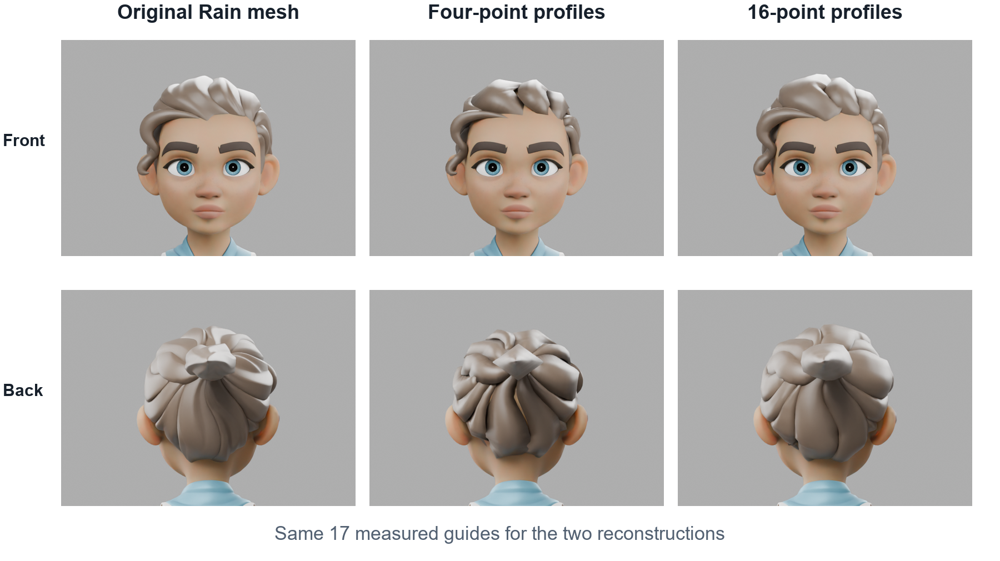
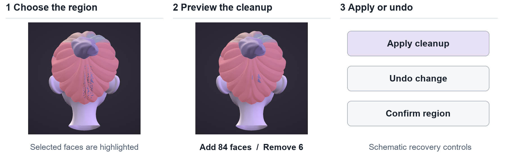
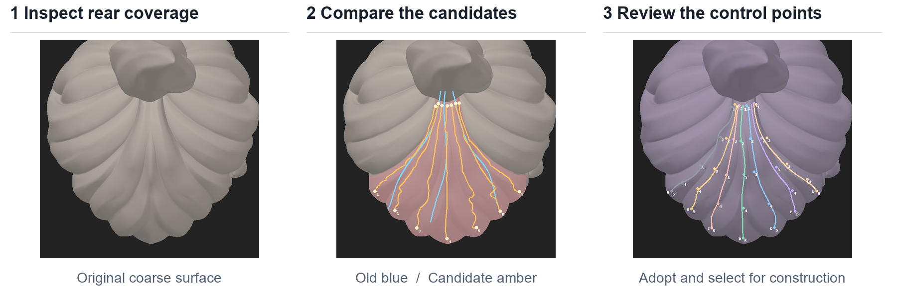
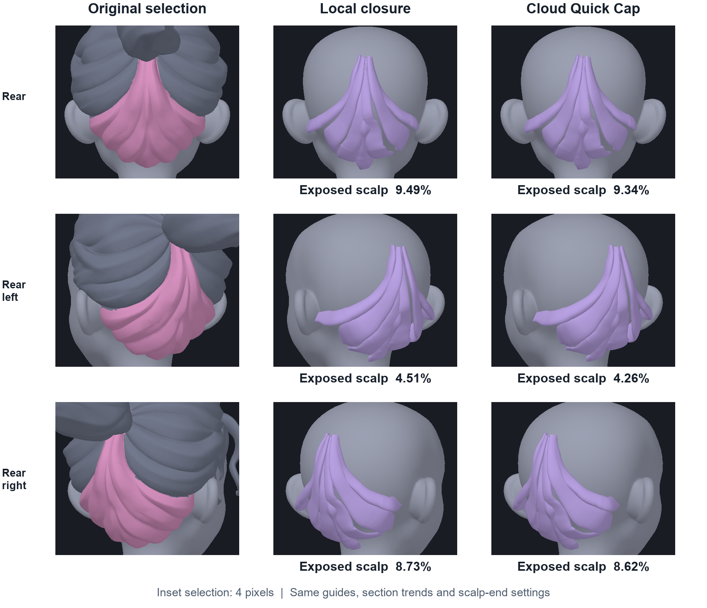

# HairBridge Studio

**A2 Project Report**

LU WENXUAN | 25 November 2026

**Word count:** main report 1173; abstract 208; total 1381. Main headings are included. Figures, short captions, references and repository links are excluded.

## Abstract

Generated hairstyles can look convincing as a whole while being awkward to edit. Hair pieces may be fused together or split into fragments, making it difficult to select and adjust the strand a modeller has in mind. Building on A1's focus on strand integrity and local editing effort, I developed HairBridge Studio, a local prototype for working with generated stylised hair.

The prototype combines a browser workspace with Blender tools, using reference images and rough geometry as its starting point. It connects reference review and hair separation with guide and cross-section editing, geometry construction and saving. Users can check proposed strands, adjust their flow and local width or thickness, and compare or restore versions. Stage confirmations, task states and review records keep decisions about grouping and acceptable results with the modeller.

The workflow has been completed on a Rain-derived example, including region review, guide replacement, cross-section adjustment, Blender construction and final approval. Seven guides for the back of the head produced an editable project and preview. Separate checks covered local editing, undoing cross-section changes and restoring versions. Results still need visual judgement of coverage, thickness and overlap. I have not yet tested other hairstyles or measured editing-time savings. Further seam and shape refinement using draw-hair remains future work.

## Problem and scope

For A2, I narrowed the concern raised in A1 to a practical modelling task: inspect and edit one complete strand of stylised hair. If the mesh is fused or fragmented, finding and selecting that strand can become a task of its own. HairBridge Studio connects reference images and a rough mesh with region selection, guides, cross-section controls and Blender construction, so the modeller can carry a chosen piece through to an editable result.

The implemented workflow is demonstrated on a Rain-derived example. Users can correct selections, compare and adopt guides, adjust the hair's shape, refine it in Blender and return a review copy. The region and fitting steps still use the supplied example data. The workflow has not yet been tested across other hairstyles, and I have not measured whether it saves editing time. I am continuing to improve mesh closure and explore seam and shape control with draw-hair.

## Design rationale

I first tried generating hair directly with HairDeck. Its editable control points, widths and thicknesses offered a useful starting point (He et al., 2026), following A1's discussion of CHARM (He et al., 2025). However, the results in my Rain trials differed from the reference in fringe placement, ponytail length and strand count. I kept the editable representation but reconsidered how to obtain it.

I then worked backwards from Rain v3's existing hair meshes (Blender Studio, 2025). Using their UV coordinates, I sampled sections along each piece, connected their centres into guide curves, and measured their widths, thicknesses, orientations and outlines. With the same 17 guides, replacing sections sampled at four points with measured 16-point profiles increased front-view silhouette intersection over union (IoU) from 82.23% to 94.38% (Figure 1). This gave me confidence that guides and sections could preserve the shape when reliable geometry was available. Both came from the original mesh; extracting them from generated geometry remained the next challenge.

### Figure 1. Reconstruction from the original mesh

| Front-view silhouette IoU | Result |
|---|---:|
| Initial HairDeck generation | 42.50% |
| Earlier edited version | 76.70% |
| Original guides, four-point sections | 82.23% |
| Original guides, 16-point sections | 94.38% |

The two measured reconstructions use the same 17 guides and profiles derived from the original mesh. [Measurement record](https://github.com/Misato-R/HairBridge-Studio/blob/v0.1.0-a2/docs/evidence/rain-reference-metrics.json). Rain Rig (CC) Blender Foundation | studio.blender.org.

I therefore tried Tripo Smart Mesh P2.0 as a source of coarse geometry (Tripo, 2026a). HairLRM's structural mesh constraints and HairFlow's combination of geometry and directional guidance helped explain this choice (Shen et al., 2026; Wang et al., 2026). My implementation uses geometric processing and human review. For the Rain example, I extracted head and hair components from one candidate, preserving their shared coordinate frame.

The extracted guides could still wobble or twist. In the S-curl test, ordinary smoothing reduced local silhouette IoU from 88.52% to 67.13%; preserving the main bend retained 82.25% (Figure 2). I therefore included confirmation of roots, tips and major bends, with comparisons before adopting replacement guides.

I also compared local mesh closure with Tripo's cloud Quick Cap (Tripo, 2026b) to investigate incomplete measurement surfaces. Keeping guides, section trends and settings at the scalp ends unchanged, the cloud result slightly reduced exposed scalp in three views. In the rear-left view, within a selection inset by four pixels, exposure fell from 4.51% to 4.26%: a relative reduction of about 5.5%, or 0.25 percentage points. The cloud mesh still had openings, and the reconstructed hair bulged slightly further out, so this step remains under development.

These trials shaped three decisions for the user: which faces belong to a strand, whether its guide follows the intended flow, and whether its volume and overlap look right. Selection brushes make the target explicit, addressing the gulf of execution. Overlaid guides and matching camera views make changes visible, addressing the gulf of evaluation. Local cross-section controls adjust width, thickness, roundness and ends. Previews, undo and version restoration support correction and reversibility (Amershi et al., 2019).

I wrote Surface Hair Curve Tool with Codex assistance to manage native Blender Bézier guides and groups. The bridge handles fitting and deviation checks; Stylized Hair PRO builds the geometry (Zarkov, n.d.). HairMesh and Hair Curve Toolkit supported earlier experiments and are credited separately.

### Figure 2. Smoothing and preserving the main bend

Same coarse mesh, root/tip constraints and cross-section settings; ordinary smoothing loses part of the intended curl.

## System architecture

The browser handles inspection and editing. A local Node.js service stores assets, tasks, approvals and versions, and checks that returned outputs still match the current inputs. Changing a reference invalidates downstream approvals.

Reference-image and Tripo tasks are prepared in the workspace, passed to Codex and the user's signed-in tools, then registered back in the project. Generated references, coarse models and guide proposals are reviewed before adoption. HairDeck remains an optional source of initial guides, using a separate local inference environment.

After guide and section review, a background Blender process builds the editable Blend file and GLB preview. The modeller can refine guides in Blender and return a review copy. Surface Hair Curve Tool manages curves and groups; the bridge connects them to Stylized Hair PRO. Figure 3 separates generation tools, local processing and human decisions.

### Figure 3. Components and information flow

Solid connections are implemented for the supplied study. Generation uses agent/tool handoffs; region and fitting tools use study data. The dashed branch marks further work.

## Illustrated interaction

The examples show region, guide and section decisions from separate development runs, with original viewport extracts and schematic English controls.

### S1. Correct a region

Viewport extracts and schematic recovery controls from the cleanup regression. Adding 84 faces, removing six, applying and undoing were checked.

### S2. Review replacement guides

Offline geometry inspection. Blue shows the old guides and amber the candidates. The project records adoption and construction of seven replacements.

### S3. Check a section adjustment

Schematic controls and original viewport extracts from one S-curl trial. Width and thickness use the selected range; roundness applies to the strand. Preview and built geometry are distinct.

## Results and validation

The selected Rain project records adoption of seven replacement guides. Blender produced seven editable curves, with 16 points per cross-section and 7,280 evaluated vertices. The saved Blend and preview files matched their recorded hashes, and final approval was recorded on 25 November 2026.

Separate runs checked applying and undoing region cleanup, editing one strand, undoing a section change while retaining the edited path, leaving neighbouring geometry unchanged, and restoring a version with its approval state. Before release, all 34 automated checks passed in a clean repository export; GitHub checks also passed. An isolated Blender 5.3.0 profile verified installation of both author-developed add-ons, language switching, synthetic strand construction, edit/restore and reopening. These records identify the different runs involved.

The section comparison also showed a trade-off. In the rear view, fitting and smoothing sections reduced the 95th percentile of outward depth from 22.56 to 20.02 mm, while projected coverage fell from 87.92% to 85.41% (Figure 5). I therefore kept multiple camera views available before final approval.

### Figure 4. Local closure and cloud Quick Cap

Columns: original selection, reconstruction using local closure, reconstruction using Quick Cap. Selection inset: four pixels. Cloud output retained 12 boundary edges and 24 non-manifold edges. [Metrics](https://github.com/Misato-R/HairBridge-Studio/blob/ed3c27b6880f0c02220deaf92617b16db83e13b7/docs/evidence/closure-comparison-metrics.json); [topology/alignment record](https://github.com/Misato-R/HairBridge-Studio/blob/ed3c27b6880f0c02220deaf92617b16db83e13b7/docs/evidence/closure-topology-alignment.json).

### Figure 5. Rear-section fitting

Same guides, head and cameras. Coverage measures overlap with the visible coarse-mesh rear selection; it is different from Figure 1's silhouette IoU. [Metrics](https://github.com/Misato-R/HairBridge-Studio/blob/v0.1.0-a2/docs/evidence/uv-section-metrics.json).

## Reflection and further work

The tests changed what I looked for in an improvement. A smoother guide can erase a deliberate curl, and less bulging can come with less coverage. The useful response was to make those changes easy to compare and reverse, while keeping the modeller's shape decisions visible.

The selected workflow is complete, but local gaps, intersections and overall styling still need visual judgement. I treat the closed mesh as a measurement aid whose distortion also needs checking. Draw-hair trials have not yet resolved seams or intersections, so the submitted geometry route continues to use Stylized Hair PRO.

Next I would test more hairstyles through actual modelling tasks, recording correction work and time. That would help establish whether the region, guide and section controls reduce editing effort beyond this example.

## Development and delivery

I defined the problem, chose the development route and prepared the dataset. I developed Surface Hair Curve Tool and the workflow with Codex assistance in coding, debugging and verification. The release includes both author-developed installers, verification tools, five reference images and a reusable seven-guide example. The English interface also supports Chinese. Stylized Hair PRO is a separate dependency, with a private assessment attachment prepared for the teacher. Sources, AI assistance and significant changes are documented in the README and development record.

## Repository and submitted version

- [Public repository](https://github.com/Misato-R/HairBridge-Studio)
- [Release v0.1.0-a2](https://github.com/Misato-R/HairBridge-Studio/releases/tag/v0.1.0-a2)
- Code commit: `5df5f1383f38d87e0148a34529e5b7cb841050a2`
- [README](https://github.com/Misato-R/HairBridge-Studio/blob/ed3c27b6880f0c02220deaf92617b16db83e13b7/README.md), [development record](https://github.com/Misato-R/HairBridge-Studio/blob/ed3c27b6880f0c02220deaf92617b16db83e13b7/docs/development.md), [reproduction guide](https://github.com/Misato-R/HairBridge-Studio/blob/ed3c27b6880f0c02220deaf92617b16db83e13b7/docs/reproduction.en.md)
- [Release verification](https://github.com/Misato-R/HairBridge-Studio/blob/v0.1.0-a2/docs/release-verification.json), [final project record](https://github.com/Misato-R/HairBridge-Studio/blob/v0.1.0-a2/docs/evidence/final-workflow.json), [earlier round-trip checks](https://github.com/Misato-R/HairBridge-Studio/blob/v0.1.0-a2/docs/evidence/earlier-workflow-verification.json)

Figure 4 supplements the fixed code release. [Documentation and closure evidence commit ed3c27b](https://github.com/Misato-R/HairBridge-Studio/commit/ed3c27b6880f0c02220deaf92617b16db83e13b7); [comparison and limitations](https://github.com/Misato-R/HairBridge-Studio/blob/ed3c27b6880f0c02220deaf92617b16db83e13b7/docs/evidence/closure-comparison.md).

## References and tool credits

Amershi, S., Weld, D., Vorvoreanu, M., Fourney, A., Nushi, B., Collisson, P., Suh, J., Iqbal, S., Bennett, P. N., Inkpen, K., Teevan, J., Kikin-Gil, R., & Horvitz, E. (2019). Guidelines for human-AI interaction. In *Proceedings of the 2019 CHI Conference on Human Factors in Computing Systems*. [DOI](https://doi.org/10.1145/3290605.3300233); [publication record](https://www.microsoft.com/en-us/research/publication/guidelines-for-human-ai-interaction/).

Blender Studio. (2025, May 8). *Rain v3* [3D character asset]. [Original asset](https://studio.blender.org/characters/rain/v3/). Rain Rig (CC) Blender Foundation | studio.blender.org.

He, Y., Zhou, Y., Zhao, W., Ye, J., Bai, Y., Xiao, K., Liu, Y.-J., Sun, Z., & Yang, W. (2025). *CHARM: Control-point-based 3D anime hairstyle auto-regressive modeling* [Preprint]. arXiv. [Paper](https://arxiv.org/abs/2509.21114); [DOI](https://doi.org/10.48550/arXiv.2509.21114).

He, Y., Wei, Y., Zhao, W., Chen, C., Zhou, Y., & Liu, Y.-J. (2026). *HairDeck: Animation-ready stylized hair cards from a single image* [Preprint]. arXiv. [Paper](https://arxiv.org/abs/2610.40599); [DOI](https://doi.org/10.48550/arXiv.2610.40599).

Qingtianyu (晴天雨). (n.d.). *Introduction and demonstration of a Blender hair-curve add-on* [Video]. Bilibili. [Author's demonstration](https://www.bilibili.com/video/BV1rqpe6sEVU/). Hair Curve Toolkit 0.24.18 was privately supplied for the project's earlier section experiments; only the demonstration link is provided here.

riel-gab. (n.d.). *HairMesh* (Version 1.1.1) [Blender add-on]. [Repository](https://github.com/riel-gab/hairmesh); [version used](https://github.com/riel-gab/hairmesh/releases/tag/v1.1.1). Used in earlier guide round-trip experiments.

Shen, Y., Dong, Y., Huang, X., Zheng, Z., Zheng, Y., & Wu, K. (2026). *HairLRM: Strand-based hair modeling via large reconstruction models* [Preprint]. arXiv. [Version consulted](https://arxiv.org/html/2606.15238v1); [published paper DOI](https://doi.org/10.1145/3799902.3811071).

Tripo. (2026a, October). *P Series (Smart Mesh)*. [Product documentation](https://www.tripo3d.ai/product-doc/ai-3d-models/p-series-smart-mesh).

Tripo. (2026b, October). *Segmentation*. [Product documentation](https://www.tripo3d.ai/product-doc/module-post-processing/segmentation). Used in earlier separation trials; the current example's connected-component extraction is described in the rationale.

Wang, Y., Wu, K., Yi, R., Lu, Z., Wang, T., Zheng, Z., Ma, L., & Shen, Y. (2026). *HairFlow: Modeling 3D hair strands with multi-modal conditioned diffusion* [Preprint]. arXiv. [Paper](https://arxiv.org/abs/2610.17348).

Zarkov, D. (n.d.). *Stylized Hair PRO* (Version 4.3.1) [Blender add-on]. [Author's product page](https://deanzarkov.gumroad.com/l/stylized_hair_pro).

LU WENXUAN prepared the project dataset and authored Surface Hair Curve Tool 0.1.0 with Codex assistance. Original character assets, external models and third-party tools retain their respective credits. Numerical results and comparison images in this report come from the project's own experiments.
