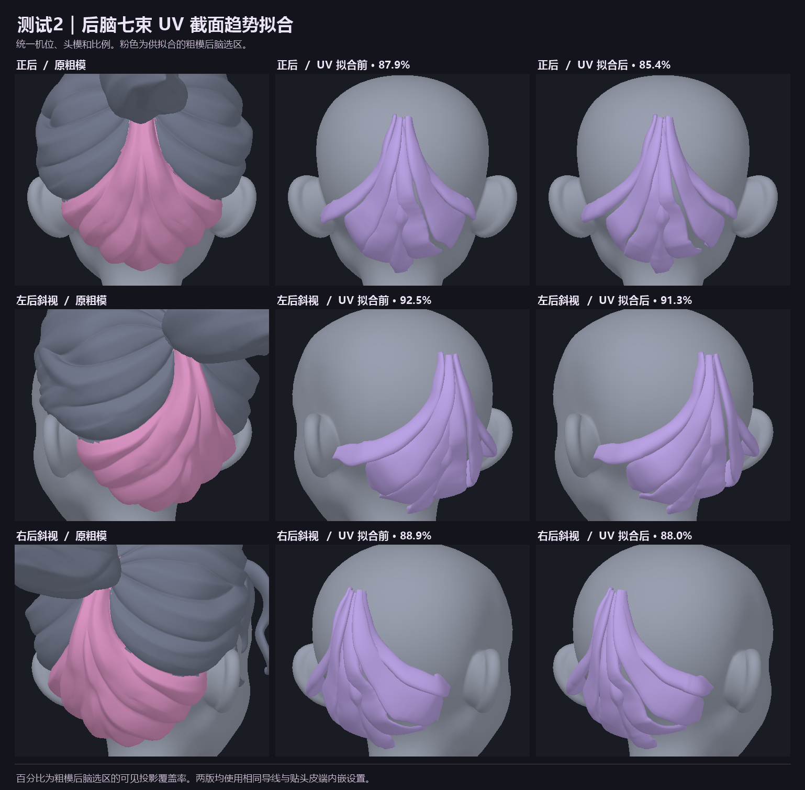

# HairBridge Studio 提交范围与后续验证

截至2026年11月25日，选定样例的主工作流已完成，测试2保存了最终确认。draw-hair 的接缝与造型试验属于后续优化。本页区分运行成功、交互检查、形体指标和未验证的收益。

## 已完成的主线

| 验证内容 | 可核对结果 | 证据 |
|---|---|---|
| 面选区修正、清理及撤销 | 同一次试跑预览补选84面、减选6面，采用和撤销均检查；原项目保持不变 | [回归记录](evidence/region-regression.json) |
| 后脑导线重做与采用 | 项目保留收到七束候选、采用方案、勾选构建及完成确认记录 | [项目状态摘录](evidence/final-workflow.json) |
| 当前真实样例构建 | Blender 5.3.0；7导线、每束16截面点、7,280评估顶点；Blend与GLB均存在且哈希匹配 | 同上 |
| 局部编辑、撤销及返回 | 较早的两束真实素材检查中，截面撤销保留已编辑走向，邻束保持一致；版本恢复带回相应审核状态 | [往返记录](evidence/earlier-workflow-verification.json) |
| 自动回归 | 2026-11-25发布检查34项全部通过；包含关键点约束、选区清理、截面趋势、端部、状态和项目导出 | `npm test`，仓库 `tests/` |
| 自编插件独立安装 | 最新ZIP在新的临时用户配置通过安装、合成导线构建、控制点编辑恢复及保存重开 | [安装验证](installer-functional-check.json) |

最终确认是作者对本项目样例的完成确认，不是参与者评价。不同版本、不同试跑的证据各自保留边界，不能组合成一次新的全流程测试。

## 后脑截面：改善深度不等于所有指标都上升

同一组七束导线、端部内嵌设置、头模与机位下，沿导线测量和平滑截面的结果如下。

| 机位 | 覆盖率：前→后 | 外凸深度P95：前→后 | 绝对深度误差中位数：前→后 |
|---|---|---|---|
| 正后 | 87.92% → 85.41% | 22.56 → 20.02 mm | 5.12 → 5.43 mm |
| 左后斜视 | 92.46% → 91.31% | 23.45 → 20.40 mm | 5.41 → 5.77 mm |
| 右后斜视 | 88.91% → 87.98% | 26.32 → 21.56 mm | 5.13 → 5.29 mm |

覆盖率为已显示SHP几何与可见粗模后脑选区重合的投影像素数，除以该可见选区像素数。深度指标只在两者重合的像素上计算，P95采用生成发片相对粗模的有符号深度差。它不是表面全局距离，也不能直接与原模转换的轮廓交并比比较。[原始数值](evidence/uv-section-metrics.json)。

这组参数压低了较大的外凸，同时损失了一部分投影覆盖，绝对深度误差中位数略增。报告将它用于解释多机位审核和可调整参数，不作为全面提升或最优参数的证据。

## 闭合测量粗模的边界

当前辅助测量网格由体素方式闭合：记录中的开放边从556降为0，非流形边从17降为0；同时记录表面偏差P95为8.513 mm。它是可测量的替代网格，不能据此认定与原粗模完全一致。原输入与辅助测量资产分别保存。[记录](evidence/final-workflow.json)。

## draw-hair 与提交范围

已有独立试验检查 draw-hair 与 SHP 对半径、倾斜及外束接缝处理的响应，但尚未将该分支作为最终交付主线。后续几何检查仍出现邻束三角面相交，不能写成接缝或穿插已经解决。本次提交以已确认的SHP主线为准；后续可比较两种几何方式对发梢、搭接和可编辑性的影响。

## 图像与来源

本页及报告图来自本项目实验；Rain 原始角色来源为 [Blender Studio Rain v3](https://studio.blender.org/characters/rain/v3/)，粗模部分为基于其参考图的Tripo生成输出。工具作者和外部模型的引用见[来源说明](../THIRD_PARTY_NOTICES.md)。[证据文件清单](evidence/provenance.json)保存各复制文件的原路径及SHA-256；不包含SHP代码、账号、密钥或模型权重。
